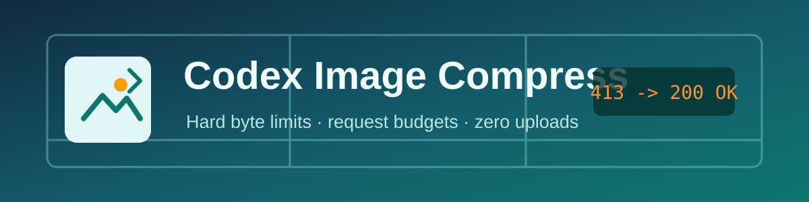
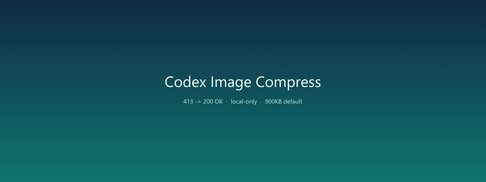

<p align="center">
  
</p>

<p align="center">
  Shrink oversized images before model uploads and avoid <code>413 Payload Too Large</code>.
</p>

<p align="center">
  <a href="README.md">中文</a> ·
  <a href="#quick-start">Quick Start</a> ·
  <a href="#codex-skill">Codex Skill</a> ·
  <a href="#command-line">Command Line</a> ·
  <a href="#development">Development</a>
</p>

<p align="center">
  <a href="https://github.com/miku1130/codex-image-compress/actions/workflows/test.yml"></a>
  <a href="LICENSE"></a>
  
</p>

> **Codex Image Compress** is a local image compression CLI and Codex Skill built for model upload limits and HTTP 413 errors.

## Why It Exists

Screenshots, photos, and design exports are often 10 MB or more. A model request may fail with only `413 Payload Too Large`, leaving you to guess whether the problem is dimensions, format, or the base64-expanded request body.

Codex Image Compress handles three things locally:

- **Hard byte limits**: search quality and dimensions until the output fits a precise target.
- **Request-body estimates**: account for base64 and multipart overhead before a 413 happens.
- **Visual fidelity**: use WebP for photos, keep PNG for screenshots, and preserve alpha and animation frames.

Everything runs on your machine. Images are never uploaded, and no cloud account is required.

## Highlights

| Capability | Details |
| --- | --- |
| Per-image limit | `--max-bytes 900KB`, accepts `KB`, `MB`, or raw bytes |
| Request budget | `--request-limit 4MB`, a conservative base64 estimate |
| Adaptive resizing | Preserves quality first, then reduces the longest edge |
| Multiple formats | WebP, JPEG, PNG, AVIF, GIF, or `auto` from input |
| Alpha preservation | PNG/WebP alpha stays intact instead of filling black or white |
| Animation | GIF/WebP frame count and playback metadata are retained |
| EXIF orientation | Phone photos stay upright |
| Batch processing | Files, directories, globs, and recursive scans |
| Safe output | Originals untouched, duplicate names numbered automatically |
| Integration | JSON output, exit codes, dry-run, and a PowerShell wrapper |

## Quick Start

Python 3.10 or newer is required.

```powershell
py -3.12 -m pip install pillow
```

Compress one image:

```powershell
py -3.12 .\scripts\image_compress.py `
  "C:\photos\screenshot.png" `
  --max-bytes 900KB `
  --max-edge 1600
```

On Windows, the wrapper works too:

```powershell
& .\scripts\compress-image.ps1 `
  "C:\photos\screenshot.png" `
  --max-bytes 900KB
```

The result goes to a `compressed/` folder next to the source:

```text
screenshot.png -> compressed/screenshot-compressed.webp
12.2 MB -> 0.4 MB
1200x800 WEBP q=95
```

## 413 Playbook

Start with a safe per-image budget, often 900 KB:

```powershell
py -3.12 .\scripts\image_compress.py .\image.png --max-bytes 900KB --max-edge 1600
```

If the endpoint still returns 413, tighten it in this order:

```powershell
# 1. Conservative: most screenshots and photos
py -3.12 .\scripts\image_compress.py .\image.png --max-bytes 700KB --max-edge 1440

# 2. Multi-image requests: split the overall budget
py -3.12 .\scripts\image_compress.py .\image.png --max-bytes 500KB --max-edge 1280

# 3. Keep pixel dimensions, reduce bytes only
py -3.12 .\scripts\image_compress.py .\image.png --max-bytes 500KB --no-resize
```

When several images are sent together, 413 usually applies to the **whole request body**, not one file:

```text
per-image budget = request limit / image count - text and protocol overhead
```

`--request-limit` checks the base64 estimate for each image. For multi-image batches, start at `--max-bytes 500KB` or lower.

## Codex Skill

Install this repository into the Codex skills directory to use it as a Skill:

```powershell
$skillRoot = Join-Path $env:USERPROFILE ".codex\skills"
New-Item -ItemType Directory -Force -Path $skillRoot | Out-Null
Copy-Item -Recurse -Force .\codex-image-compress "$skillRoot\image-compress"
```

Then ask Codex:

```text
Use $image-compress to shrink this image below 900KB before sending it.
```

`SKILL.md` gives Codex the default workflow, 413 fallback order, and output rules. The CLI entry point and detailed flags stay in `scripts/` and `references/`, loaded only when needed.

## Command Line

### One File

```powershell
py -3.12 .\scripts\image_compress.py photo.jpg
```

The default is WebP, at most 900 KB and 1600 px on the longest edge.

### A Directory

```powershell
py -3.12 .\scripts\image_compress.py .\screenshots `
  --recursive `
  --output-dir .\compressed `
  --max-bytes 700KB
```

### Keep Screenshots Sharp

```powershell
py -3.12 .\scripts\image_compress.py .\ui.png `
  --format png `
  --max-bytes 1MB `
  --max-edge 2048
```

PNG is lossless. If it still exceeds the budget, the tool shrinks the canvas step by step; switch to WebP when you need a smaller file.

### Transparent Assets

```powershell
py -3.12 .\scripts\image_compress.py .\logo.png `
  --format webp `
  --max-bytes 300KB
```

### Animation

```powershell
py -3.12 .\scripts\image_compress.py .\animation.gif `
  --format webp `
  --max-bytes 1MB
```

### Programmatic Use

```powershell
py -3.12 .\scripts\image_compress.py .\image.png --json
```

The JSON result includes:

- `output`: output file path
- `output_bytes`: final byte size
- `width`, `height`: output dimensions
- `quality`: final encoder quality, `null` for PNG
- `request_bytes`: conservative base64 + multipart estimate
- `skipped`: `true` when `--skip-smaller` leaves a small source untouched

Exit codes: `0` all succeeded, `1` at least one failure, `2` invalid arguments or input.

## Options

| Option | Default | Description |
| --- | --- | --- |
| `--max-bytes` | `900KB` | Per-image byte limit |
| `--request-limit` | `4MB` | Estimated request-body limit; `0` disables it |
| `--max-edge` | `1600` | Longest-edge pixel limit |
| `--min-quality` | `60` | Lowest quality in the search |
| `--format` | `webp` | `auto`, `jpeg`, `png`, `webp`, `avif`, `gif` |
| `--output` / `-o` | `compressed/` | Output file or directory |
| `--output-dir` | none | Shared output directory for batches |
| `--recursive` | off | Scan directories recursively |
| `--no-resize` | off | Adjust quality only |
| `--overwrite` | off | Replace existing outputs |
| `--skip-smaller` | off | Copy small sources instead of re-encoding |
| `--dry-run` | off | Analyze without writing files |
| `--json` | off | Emit machine-readable results |

See [references/cli.md](references/cli.md) for the full reference.

## Example Output

The image below shows a 6000x4000 photo compressed to 1200x800 inside a 500 KB budget. It is a visual quality sample only; processing happens locally.

<p align="center">
  
</p>

## Design Principles

**The byte target is a hard constraint.** The search never returns an "almost fits" file because it hit the quality floor or size limit. Bytes and request budget are checked again before anything is written.

**Quality first, dimensions second.** Photos usually fit through quality search at full size. The canvas shrinks only after quality is exhausted, preserving text, edges, and texture for longer.

**Originals stay untouched.** Output goes to `compressed/`; collisions get numbered names, so a source file is never silently replaced.

## Development

```powershell
git clone https://github.com/miku1130/codex-image-compress.git
cd codex-image-compress
py -3.12 -m pip install -r requirements-dev.txt
py -3.12 -m unittest discover -s scripts -p "test_*.py" -v
```

Tests cover byte limits, alpha preservation, request budgets, dry-run, batch naming, and animation frame counts. CI runs the same suite on Python 3.10, 3.11, and 3.12.

Before committing:

```powershell
py -3.12 -m py_compile .\scripts\image_compress.py
py -3.12 -m unittest discover -s scripts -p "test_*.py"
```

## FAQ

**Why WebP by default?**
WebP is usually smaller than JPEG or PNG for both photos and screenshots, and it supports alpha. Use `--format jpeg` when an upload endpoint needs broad compatibility.

**Text looks blurry after compression.**
Raise `--max-edge` first, then lower the quality floor in `--max-bytes` terms. For screenshots, try `--format png` or `--format webp --min-quality 75`.

**Why is the output much smaller than 900KB?**
The search starts at high quality and stops at the first result that fits. Some images fit well below the limit at the highest tested quality.

**Are images uploaded?**
No. The tool only uses local Pillow encoders and makes no network requests.

## License

MIT License. See [LICENSE](LICENSE).
