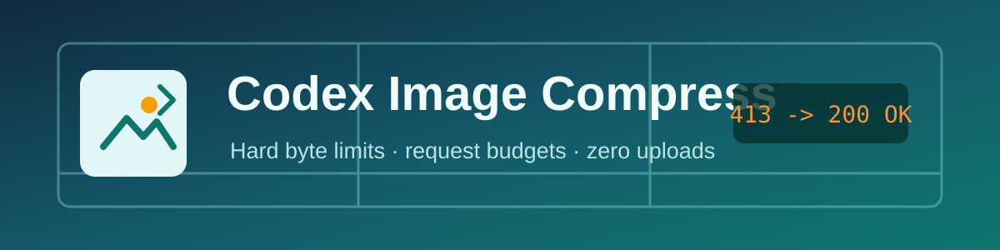
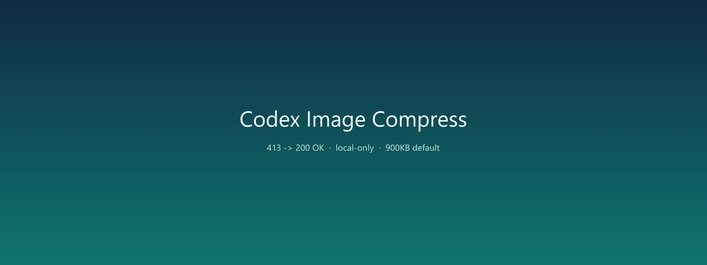

<p align="center">
  
</p>

<p align="center">
  把超大图片压到模型能接收的尺寸，避免 <code>413 Payload Too Large</code>。
</p>

<p align="center">
  <a href="README.en.md">English</a> ·
  <a href="#快速开始">快速开始</a> ·
  <a href="#codex-skill">Codex Skill</a> ·
  <a href="#命令行">命令行</a> ·
  <a href="#开发">开发</a>
</p>

<p align="center">
  <a href="https://github.com/miku1130/codex-image-compress/actions/workflows/test.yml"></a>
  <a href="LICENSE"></a>
  
</p>

> **Codex Image Compress** 是一个本地图片压缩工具与 Codex Skill，面向模型上传场景的体积限制与 HTTP 413 问题。

## 为什么需要它

把截图、照片或设计稿直接贴给模型时，原始文件经常达到十几 MB。接口拒绝请求时只返回一句 `413 Payload Too Large`，很难判断究竟是尺寸、格式还是 base64 编码后的体积超限。

Codex Image Compress 在本地完成三件事：

- **精确控制文件体积**：以目标字节数为硬上限，自动搜索质量与尺寸。
- **估算真实请求体**：同时计算 base64 与 multipart 开销，提前拦截可能触发 413 的图片。
- **保留视觉质量**：照片走 WebP，截图可保持 PNG，透明通道与动图帧数完整保留。

所有处理都在本机完成，不上传图片，不需要云端账号。

## 亮点

| 能力 | 说明 |
| --- | --- |
| 单图上限 | `--max-bytes 900KB`，支持 `KB`、`MB` 和纯字节数 |
| 请求预算 | `--request-limit 4MB`，按 base64 后体积做保守估算 |
| 智能缩放 | 优先保画质，超出预算时才逐步缩小最长边 |
| 多格式输出 | WebP、JPEG、PNG、AVIF、GIF，`auto` 跟随输入 |
| 透明保护 | PNG/WebP 保留 alpha，不把透明区填黑或填白 |
| 动图支持 | GIF/WebP 动画保持帧数与播放信息 |
| EXIF 方向 | 手机竖拍照片不会出现方向错误 |
| 批量处理 | 目录、通配符、多文件与递归扫描 |
| 安全交付 | 默认不覆盖原图，同名结果自动编号 |
| 可集成 | JSON 输出、退出码、dry-run 与 PowerShell 启动器 |

## 快速开始

需要 Python 3.10 或更高版本。

```powershell
py -3.12 -m pip install pillow
```

压缩一张图片：

```powershell
py -3.12 .\scripts\image_compress.py `
  "C:\photos\screenshot.png" `
  --max-bytes 900KB `
  --max-edge 1600
```

Windows 用户可以使用包装器：

```powershell
& .\scripts\compress-image.ps1 `
  "C:\photos\screenshot.png" `
  --max-bytes 900KB
```

结果默认写入原图旁的 `compressed/` 目录：

```text
screenshot.png -> compressed/screenshot-compressed.webp
12.2 MB -> 0.4 MB
1200x800 WEBP q=95
```

## 413 应答手册

先按接口的实际限制压缩。常见安全起点是单图 900 KB：

```powershell
py -3.12 .\scripts\image_compress.py .\image.png --max-bytes 900KB --max-edge 1600
```

仍触发 413 时，按下面顺序收紧：

```powershell
# 1. 保守档，适合多数截图与照片
py -3.12 .\scripts\image_compress.py .\image.png --max-bytes 700KB --max-edge 1440

# 2. 多图对话，按总请求预算分配
py -3.12 .\scripts\image_compress.py .\image.png --max-bytes 500KB --max-edge 1280

# 3. 只压缩字节，不改变像素尺寸
py -3.12 .\scripts\image_compress.py .\image.png --max-bytes 500KB --no-resize
```

如果一次发送多张图片，413 往往来自**整个请求体**而不是某一张图。先估算总预算：

```text
单图预算 = 请求上限 / 图片数量 - 文本与协议开销
```

脚本用 `--request-limit` 检查单张图的 base64 估算；批量多图时，建议把 `--max-bytes` 设为 `500KB` 或更低。

## Codex Skill

把本仓库放到 Codex 的 skills 目录即可作为 Skill 使用：

```powershell
$skillRoot = Join-Path $env:USERPROFILE ".codex\skills"
New-Item -ItemType Directory -Force -Path $skillRoot | Out-Null
Copy-Item -Recurse -Force .\codex-image-compress "$skillRoot\image-compress"
```

在对话中可以直接说：

```text
用 $image-compress 把这张图压到 900KB 以内，再发给模型。
```

Skill 的 `SKILL.md` 会把默认处理流程、413 排查顺序和输出约定提供给 Codex；脚本入口和命令行参考保持在 `scripts/` 与 `references/` 中，按需读取。

## 命令行

### 单文件

```powershell
py -3.12 .\scripts\image_compress.py photo.jpg
```

默认输出 WebP，单图不超过 900 KB，最长边 1600 px。

### 批量目录

```powershell
py -3.12 .\scripts\image_compress.py .\screenshots `
  --recursive `
  --output-dir .\compressed `
  --max-bytes 700KB
```

### 保持截图清晰

```powershell
py -3.12 .\scripts\image_compress.py .\ui.png `
  --format png `
  --max-bytes 1MB `
  --max-edge 2048
```

PNG 是无损格式，如果仍然超过预算，脚本会逐步缩小画布；需要更小体积时改用 WebP。

### 透明素材

```powershell
py -3.12 .\scripts\image_compress.py .\logo.png `
  --format webp `
  --max-bytes 300KB
```

### 动图

```powershell
py -3.12 .\scripts\image_compress.py .\animation.gif `
  --format webp `
  --max-bytes 1MB
```

### 程序集成

```powershell
py -3.12 .\scripts\image_compress.py .\image.png --json
```

返回字段包括：

- `output`：压缩结果绝对或相对路径
- `output_bytes`：最终字节数
- `width`、`height`：输出尺寸
- `quality`：最终编码质量，PNG 为 `null`
- `request_bytes`：base64 + multipart 的保守估算
- `skipped`：源图小于目标且启用 `--skip-smaller` 时为 `true`

退出码：`0` 表示全部成功，`1` 表示至少一张失败，`2` 表示参数或输入错误。

## 参数速查

| 参数 | 默认值 | 说明 |
| --- | --- | --- |
| `--max-bytes` | `900KB` | 单图字节上限 |
| `--request-limit` | `4MB` | base64 请求体估算上限，`0` 关闭 |
| `--max-edge` | `1600` | 最长边像素上限 |
| `--min-quality` | `60` | 自动搜索的最低质量 |
| `--format` | `webp` | `auto`、`jpeg`、`png`、`webp`、`avif`、`gif` |
| `--output` / `-o` | `compressed/` | 输出文件或目录 |
| `--output-dir` | 无 | 批量统一输出目录 |
| `--recursive` | 关闭 | 递归扫描目录 |
| `--no-resize` | 关闭 | 只调质量，不缩尺寸 |
| `--overwrite` | 关闭 | 覆盖同名输出 |
| `--skip-smaller` | 关闭 | 小图直接复制，不重新编码 |
| `--dry-run` | 关闭 | 只分析，不写文件 |
| `--json` | 关闭 | 输出机器可读结果 |

完整说明见 [references/cli.md](references/cli.md)。

## 示例图

下面是一张 6000x4000 测试照片压到 1200x800、500KB 预算以内的示例；它用于展示视觉质量，实际处理全部在本地完成。

<p align="center">
  
</p>

## 设计原则

**目标字节数是硬约束。** 搜索过程不会因为质量下限或尺寸上限而返回一个“看起来接近”的超限文件；最终写入前会再次检查字节数和请求预算。

**质量优先，再降尺寸。** 照片通常能在原尺寸下通过质量搜索进入预算；只有画质已经触底时才缩小画布。这样既能压小体积，也能保留文字、边缘与纹理。

**原始素材不动。** 默认写入 `compressed/`，重名自动加序号，避免覆盖用户唯一的源文件。

## 开发

```powershell
git clone https://github.com/miku1130/codex-image-compress.git
cd codex-image-compress
py -3.12 -m pip install -r requirements-dev.txt
py -3.12 -m unittest discover -s scripts -p "test_*.py" -v
```

测试覆盖体积上限、透明通道、请求预算、dry-run、批量重名与动图帧数。CI 在 Python 3.10、3.11、3.12 上运行同一套测试。

提交前建议执行：

```powershell
py -3.12 -m py_compile .\scripts\image_compress.py
py -3.12 -m unittest discover -s scripts -p "test_*.py"
```

## 常见问题

**为什么默认是 WebP？**
WebP 在照片和截图上的体积通常比 JPEG/PNG 小，同时支持透明通道。需要上传接口兼容性时用 `--format jpeg`。

**压缩后文字变糊怎么办？**
先提高 `--max-edge`，再降低 `--max-bytes` 允许的质量下限。截图可尝试 `--format png`，或用 `--format webp --min-quality 75`。

**为什么设置了 900KB，输出却更小？**
这是正常的。脚本按质量从高到低搜索，第一次满足预算就停止；有时高质量结果本身已经远低于上限。

**图片会不会被上传？**
不会。脚本只使用本机 Pillow 编解码，不调用网络接口。

## 许可证

MIT License，见 [LICENSE](LICENSE)。
